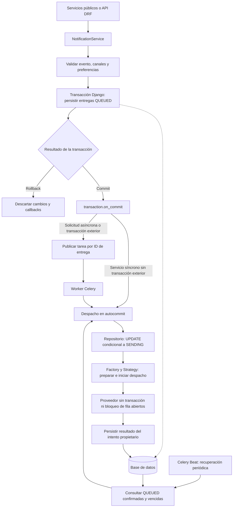

# Notifications System

[](https://github.com/mikelm2020/notifications_system/actions/workflows/ci.yml)

**Notificaciones multicanal para Django con intención de envío persistente y despacho después del commit.**

Un evento de negocio puede generar mensajes por varios canales. Enviarlos antes de confirmar la transacción permite que un usuario reciba una notificación de una operación revertida; depender solo del broker puede perder la intención de envío si falla la publicación. Este proyecto aborda ambos problemas con registros persistentes, un límite transaccional explícito y recuperación periódica.

La app `notifications` centraliza tipos de evento, plantillas, preferencias y estados de entrega. El proyecto Django incluido permite explorar el sistema localmente sin credenciales ni envíos externos. Como proyecto de portafolio Backend Python, muestra diseño por capas, concurrencia en PostgreSQL, pruebas de fallos e integración continua, junto con sus límites operativos.

## Qué incluye

- Nueve estrategias de canal y proveedores desacoplados mediante Strategy y Factory.
- Plantillas con sintaxis Django, categorías y asociaciones entre eventos y canales.
- Preferencias globales por canal o específicas por tipo de notificación.
- Servicios síncronos y asíncronos, envíos por canal, lotes y programación persistente.
- Entregas identificadas por `(uuid, channel_id)`, reclamación atómica y presupuesto compartido de reintentos.
- API REST con autenticación, administración Django, dispositivos y cuentas externas de usuario.
- Signals para integrar observadores de creación, envío, lectura y fallo permanente.
- Pruebas de commit, rollback, recuperación, reentrega y concurrencia con PostgreSQL real.

### Stack

| Componente | Uso en el repositorio |
| --- | --- |
| Python 3.12 | Versión utilizada en CI; el proyecto declara Python ≥ 3.12 |
| Django 5.x | ORM, transacciones, plantillas, admin y migraciones |
| Django REST Framework | Serializers, ViewSets y router de la API |
| PostgreSQL 16 + psycopg 3 | Backend real de las pruebas de integración y CI |
| SQLite | Exploración local sin servicios adicionales |
| Celery 5.x + Beat | Despacho, reintentos y recuperación periódica |
| Redis | Cliente y configuración de broker/backend para una integración con workers |
| HTTPX y SDK opcionales | Adaptadores de proveedores externos |
| Poetry y pytest | Dependencias versionadas y pruebas automatizadas |
| Ruff y GitHub Actions | Checks estáticos y CI |

Las restricciones exactas y dependencias opcionales están en [pyproject.toml](pyproject.toml); [poetry.lock](poetry.lock) fija la resolución. Redis y workers reales no son necesarios para las pruebas: estas usan Celery eager y memoria.

### Canales implementados

| Canal | Identificador | Adaptador / dependencia opcional |
| --- | --- | --- |
| Email | `email` | SMTP mediante Django; sin SDK adicional |
| In-App | `in_app` | Persistencia local; WebSocket opcional con Channels y Channels Redis |
| SMS | `sms` | Twilio; extra `sms` |
| Push móvil | `push_fcm` | Firebase Admin; extra `push-fcm` |
| Push web | `push_web` | pywebpush; extra `push-web` |
| WhatsApp | `whatsapp` | Twilio; extra `whatsapp` |
| Slack | `slack` | Slack SDK; extra `slack` |
| Telegram | `telegram` | HTTPX, incluido en las dependencias base |
| Webhook | `webhook` | HTTPX, incluido en las dependencias base |

La existencia del adaptador no certifica una entrega real con ese proveedor. La suite usa fakes y mocks para las llamadas externas. WebSocket requiere configurar ASGI, el channel layer y los consumidores en el proyecto que adopte la app; además, integrar la opción `use_websocket=True` al crear la estrategia, ya que el servicio no la activa automáticamente.

## Arquitectura y límite transaccional



1. El servicio crea una fila `QUEUED` por canal con el contexto y `scheduled_for`. La fila representa la intención de envío: se guarda en la misma transacción que el evento de negocio cuando el consumidor llama al servicio dentro de `transaction.atomic()`.
2. `transaction.on_commit()` inicia el despacho solo después de confirmar la transacción exterior. Un rollback, incluso de un savepoint, descarta el callback y los cambios correspondientes; no se llama al proveedor.
3. Sin transacción exterior, el servicio síncrono despacha después de su propio commit y devuelve el resultado disponible. Dentro de una transacción, devuelve entregas `QUEUED`; el callback publica `dispatch_notification` por clave primaria. El servicio asíncrono también persiste antes de publicar.
4. Una caída antes del callback o un fallo del broker deja la intención confirmada en la base. `recover_queued_notifications` busca entregas `QUEUED` vencidas cada minuto mediante Beat, sin depender de la publicación inicial.
5. El worker y la recuperación usan la misma reclamación: un `UPDATE` condicionado por estado cambia la entrega a `SENDING`. Las invocaciones concurrentes o repetidas no pueden reclamar el mismo estado dos veces.
6. La llamada al proveedor ocurre en autocommit, sin conservar bloqueos de fila ni transacciones de negocio. La finalización comprueba el estado y `dispatch_started_at` del intento propietario.

`QUEUED` significa intención persistida, no envío confirmado. Los objetos devueltos dentro de una transacción no se actualizan automáticamente por un worker; consultar nuevamente la base para conocer el resultado. Véase [el contrato transaccional](docs/transactional-dispatch.md).

### Reintentos, cancelación e incertidumbre

| Situación | Comportamiento |
| --- | --- |
| Fallo conocido | `FAILED`; reintento cuando vence la espera y queda presupuesto |
| Reintentos agotados | `failed_permanently_at` impide nuevas reclamaciones |
| Cancelación antes del inicio de despacho | El repositorio puede pasar a `CANCELLED`, incluso después de reclamar `SENDING` |
| Cancelación después del inicio | No revoca una llamada externa ya iniciada |
| Preferencia deshabilitada | Se comprueba antes del envío y después de los hooks de preparación |
| Timeout o desconexión reconocidos como ambiguos | Mantiene `SENDING` con `DELIVERY_UNKNOWN`; exige revisión, sin reintento automático |
| Caída después de reclamar o de obtener aceptación externa | `SENDING` no se recicla automáticamente para evitar un posible duplicado |
| Estado terminal o reentrega de una tarea completada | No se vuelve a reclamar para enviar |

`max_retries` permite un intento inicial y hasta ese número de reintentos. `retry_count` aumenta al reclamar una entrega `FAILED`; Celery y las tareas periódicas comparten ese presupuesto. La tarea principal también tiene un límite de reprogramaciones del mensaje. La espera se mide desde `updated_at`.

Para deduplicar solicitudes de una misma operación, proporcionar un UUID estable en `NotificationData`. Reutilizar ese UUID conserva el conjunto original de entregas; no debe pertenecer a otro usuario o evento. El mismo UUID puede aparecer en canales diferentes. **No se garantiza entrega exactamente una vez**: no existe idempotencia universal de extremo a extremo con los proveedores.

## Instalación y ejecución local

Requisitos: Git, Python 3.12 con `venv` y Poetry 2.4.1, la versión usada en CI. Para este recorrido no hacen falta Docker, Redis, PostgreSQL ni credenciales de proveedores.

```bash
git clone https://github.com/mikelm2020/notifications_system.git
cd notifications_system
python3.12 -m venv .venv
source .venv/bin/activate
poetry check --lock
poetry install --extras dev --no-root
export DJANGO_SETTINGS_MODULE=notifications_system.local
poetry run python manage.py migrate
poetry run python manage.py check
poetry run python manage.py createsuperuser
poetry run python manage.py runserver
```

Abrir `http://127.0.0.1:8000/admin/`. `local.py` registra la app, utiliza SQLite, email en memoria y Celery eager con broker/backend en memoria. `settings.py` es una plantilla de integración; utilizar `local` para este recorrido. No iniciar workers ni Beat con la configuración eager.

La base nueva queda sin categorías, eventos, canales ni plantillas de ejemplo. Crearlos desde el admin o ejecutar el siguiente ejemplo en `poetry run python manage.py shell`.

### Configurar un evento y enviar un email local

Este ejemplo es repetible y utiliza únicamente el backend de correo en memoria de `local.py`:

```python
from django.contrib.auth import get_user_model
from django.core import mail
from notifications import send_notification
from notifications.models import (
    EmailTemplate,
    NotificationCategory,
    NotificationChannel,
    NotificationType,
    NotificationTypeChannels,
)

user, _ = get_user_model().objects.get_or_create(
    username="portfolio-demo", defaults={"email": "demo@example.test"}
)
category, _ = NotificationCategory.objects.get_or_create(
    name="Transaccional", defaults={"description": "Eventos de negocio"}
)
channel, _ = NotificationChannel.objects.get_or_create(
    name="email", defaults={"description": "Correo electrónico"}
)
kind, _ = NotificationType.objects.get_or_create(
    event_code="ORDER_CREATED",
    defaults={"category_id": category, "name": "Orden creada"},
)
NotificationTypeChannels.objects.get_or_create(
    notification_type_id=kind, channel_id=channel
)
EmailTemplate.objects.update_or_create(
    notification_type_id=kind, template_name="order_created_email",
    defaults={
        "template_subject": "Orden #{{ order_number }} creada",
        "template_text": "Hola {{ user_name }}, total: {{ total }}.",
        "template_html": "<p>Orden {{ order_number }} confirmada.</p>",
    },
)

notifications = send_notification(
    event_code="ORDER_CREATED", user_id=user.pk, channels=["email"],
    context={
        "order_number": "12345", "total": "$99.99",
        "user_name": user.username, "user_email": user.email,
    },
)
assert notifications[0].status == "sent"
assert mail.outbox[-1].to == [user.email]
```

### Integrar el envío con una transacción de negocio

Continuando en el mismo shell con el evento anterior:

```python
from uuid import uuid4
from django.db import transaction
from notifications.dtos.notification_data import NotificationData
from notifications.services.notification_service import NotificationService

service = NotificationService()
data = NotificationData(
    event_code="ORDER_CREATED", user_id=user.pk, uuid=str(uuid4()),
    context={"order_number": "12346", "user_email": user.email},
)
with transaction.atomic():
    # En una aplicación real, guardar aquí la operación de negocio.
    deliveries = service.create_and_send_notification(data, channels=["email"])
    assert deliveries[0].status == "queued"

# En local, el callback ejecuta la tarea eager después del commit.
deliveries[0].refresh_from_db()
assert deliveries[0].status == "sent"
```

`create_and_send_notification(data)` usa los canales asociados al evento; `channels=[...]` selecciona canales específicos. El contexto debe incluir los destinatarios requeridos: por ejemplo, `user_email` para email o `phone_number` para SMS/WhatsApp. No se presupone que el modelo de usuario tenga un atributo `phone`.

### Solicitudes asíncronas y programadas

```python
from datetime import timedelta
from django.utils import timezone
from notifications.services.async_service import AsyncNotificationService

# Crear un DTO nuevo por cada operación; reutilizar UUID solo para deduplicarla.
async_data = NotificationData(
    event_code="ORDER_CREATED", user_id=user.pk,
    context={"order_number": "12347", "user_email": user.email},
)
delivery_uuid = AsyncNotificationService.send_async(async_data)

scheduled_data = NotificationData(
    event_code="ORDER_CREATED", user_id=user.pk,
    context={"order_number": "12348", "user_email": user.email},
)
scheduled_uuid = AsyncNotificationService.schedule_notification(
    scheduled_data, send_at=timezone.now() + timedelta(hours=1)
)
```

El wrapper devuelve un UUID de entrega, no un ID de tarea Celery. Guarda `scheduled_for` en la base; Beat procesa las entregas vencidas. En local, las tareas no programadas se ejecutan eager; para explorar una entrega programada se pueden invocar las tareas periódicas manualmente después de su vencimiento.

También existen `send_notification_async`, `send_to_channel_async`, `send_email_async`, `send_sms_async`, `send_push_async`, `send_whatsapp_async` y `send_batch_notifications` en [tasks.py](notifications/tasks.py). Para solicitudes independientes ya confirmadas:

```python
from notifications.tasks import send_email_async

result = send_email_async.delay(
    "ORDER_CREATED", user.pk, user.email, {"order_number": "12349"}
)
```

Las tareas de creación rechazan `.delay()` y `.apply_async()` dentro de transacciones abiertas, incluido eager: publicar el mensaje no persiste intención en la transacción del productor. Usar `NotificationService` o `AsyncNotificationService` para vincular la entrega a cambios de negocio. Los resultados de tareas reflejan envío confirmado, no solo creación del registro.

## Integrar la app en otro proyecto Django

La app puede copiarse como directorio `notifications/`, conservando sus migraciones. Instalar las dependencias base declaradas en `pyproject.toml` en el entorno del proyecto anfitrión y agregar:

```python
# settings.py del proyecto anfitrión
INSTALLED_APPS += ["rest_framework", "notifications.apps.NotificationsConfig"]

NOTIFICATIONS_CONFIG = {
    "CHANNELS": {
        "email": {"enabled": True, "provider": "smtp"},
        "in_app": {"enabled": True},
        "sms": {"enabled": False, "provider": "twilio"},
    },
    "DEFAULTS": {"max_retries": 3, "retry_delay": 300},
}
```

Configurar los proveedores que se habiliten mediante variables de entorno o un gestor de secretos en el proyecto anfitrión. `PROVIDERS` admite configuración para Twilio, FCM, Web Push, Slack y Telegram; SMTP usa los settings de Django. Consultar las claves y defaults en [conf.py](notifications/conf.py). Habilitar un canal requiere también sus registros, asociación con el evento, plantilla activa y dependencia opcional.

Desde este repositorio, instalar extras según necesidad, conservando los usados para desarrollo:

```bash
poetry install --extras 'dev sms whatsapp push-fcm push-web slack websocket' --no-root
# Grupos disponibles: twilio, push, all; integración PostgreSQL: postgres-tests.
```

Para una instalación nueva, aplicar las migraciones existentes:

```bash
python manage.py migrate
```

No generar un nuevo `0001` ni ejecutar `makemigrations notifications` como paso de instalación. Para tablas preexistentes, revisar primero [el procedimiento de adopción](docs/existing-installations.md).

### API REST

El proyecto de ejemplo solo monta `/admin/`. La app incluye un router DRF, pero **sus endpoints requieren incluir las URLs** en el proyecto anfitrión. Por ejemplo:

```python
from django.urls import include, path

urlpatterns += [path("api/", include("notifications.urls"))]
```

Con ese prefijo, todas las vistas requieren un usuario autenticado:

| Ruta | Método | Operación |
| --- | --- | --- |
| `/api/notifications/` | GET | Listar entregas del usuario |
| `/api/notifications/{uuid}/` | GET | Consultar detalle |
| `/api/notifications/unread/` | GET | Consultar no leídas |
| `/api/notifications/{uuid}/mark_read/` | POST | Marcar lectura |
| `/api/notifications/mark_all_read/` | POST | Marcar todas como leídas |
| `/api/notifications/stats/` | GET | Conteos por estado y canal |
| `/api/notifications/send/` | POST | Crear notificaciones; requiere `is_staff` |
| `/api/devices/` | GET, POST | Listar y registrar tokens |
| `/api/devices/{id}/` | GET, PUT, PATCH, DELETE | Gestionar un token; DELETE lo desactiva |
| `/api/devices/logout_all/` | DELETE | Desactivar los dispositivos del usuario |
| `/api/preferences/` | GET, POST | Listar y crear preferencias |
| `/api/preferences/{id}/` | GET, PUT, PATCH, DELETE | Gestionar una preferencia |
| `/api/preferences/bulk_update/` | POST | Actualización de preferencias en lote |
| `/api/preferences/available_channels/` | GET | Consultar canales disponibles |

El detalle utiliza UUID, aunque la identidad de entrega es UUID/canal: las consultas de detalle por UUID no resuelven de forma inequívoca un evento multicanal. Para seguimiento desde Python, consultar por UUID y canal o por clave primaria. No asumir una API de detalle multicanal completa.

### Workers y tareas periódicas

Para una integración con broker real, configurar una app Celery que cargue los settings del proyecto, descubra `notifications.tasks` y use un broker/backend, por ejemplo Redis. El módulo incluido muestra la configuración en [celery.py](notifications_system/celery.py). En los settings de integración debe estar `CELERY_TASK_ALWAYS_EAGER=False`.

Con un módulo de settings propio y servicios ya configurados, los comandos para la app Celery de este repositorio son:

```bash
# Sustituir mi_proyecto.settings por el módulo real de integración.
export DJANGO_SETTINGS_MODULE=mi_proyecto.settings
poetry run celery -A notifications_system worker --loglevel=INFO
# En otra terminal con el mismo módulo de settings:
poetry run celery -A notifications_system beat --loglevel=INFO
```

En un proyecto anfitrión con otra app Celery, sustituir también `-A`. Estos comandos no describen un despliegue ya validado con broker real.

| Tarea | Programación incluida |
| --- | --- |
| `recover_queued_notifications` | Cada minuto: recupera intención confirmada |
| `process_scheduled_notifications` | Cada minuto: procesa fechas vencidas, incluidas filas `PENDING` heredadas |
| `retry_failed_notifications` | Cada 15 minutos: reintenta fallos elegibles |
| `cleanup_old_notifications` | Disponible; sin programación por defecto |
| `deactivate_expired_device_tokens` | Disponible; sin programación por defecto |

Para conservar las tareas opcionales de mantenimiento, agregar entradas a `beat_schedule`, por ejemplo `crontab(hour=3, minute=0)` para limpieza y `crontab(day_of_week=0, hour=4)` para tokens, importando `crontab` desde `celery.schedules`. Recuperación necesita Beat y workers activos.

### Hooks y extensión

Los signals públicos incluyen `notification_pre_create`, `notification_post_create`, `notification_pre_send`, `notification_post_send`, `notification_read`, `notification_failed_permanently`, `device_registered`, `device_deactivated` y `preference_changed`. Ejemplo de observador:

```python
import logging
from django.dispatch import receiver
from notifications.signals import notification_post_send

logger = logging.getLogger(__name__)

@receiver(notification_post_send)
def log_notification(sender, notification, success, **kwargs):
    logger.info("Entrega %s: success=%s", notification.uuid, success)
```

Importar el módulo de receptores desde el `ready()` de la app anfitriona. Los hooks de creación se ejecutan dentro de la transacción: evitar efectos externos en ellos. Los signals no constituyen un outbox persistente de eventos; un observador puede perder un aviso ante una caída del proceso.

Para un canal personalizado, implementar `prepare_content(template, context)` y `send(notification, content)` heredando de [NotificationChannelStrategy](notifications/strategies/base_strategy.py) y registrar la clase mediante `NotificationChannelFactory.register_strategy(nombre, clase)`. También se necesita integrar el template en `CHANNEL_TEMPLATE_MAP` del servicio, el registro del canal, sus choices/configuración y la asociación con el evento. Registrar solo la estrategia no habilita el flujo completo. Los adaptadores deben distinguir rechazo conocido de resultado ambiguo.

## Pruebas y CI

Suite local rápida, desde el entorno instalado:

```bash
export DJANGO_SETTINGS_MODULE=notifications_system.local
poetry run pytest -q
```

SQLite omite los cinco casos exclusivos de PostgreSQL; no sustituye la validación de concurrencia del backend real. Para ejecutar la suite completa con una base aislada, instalar el extra e iniciar un contenedor temporal sin volúmenes:

```bash
poetry install --extras 'dev postgres-tests' --no-root
docker run --rm -d --name notifications-postgres-tests \
  -e POSTGRES_USER=notifications_test -e POSTGRES_PASSWORD=local-test-only \
  -p 127.0.0.1:55432:5432 postgres:16
docker exec notifications-postgres-tests pg_isready -U notifications_test -d postgres
# Continuar cuando pg_isready indique que acepta conexiones.
export DJANGO_SETTINGS_MODULE=notifications_system.postgres_test
export NOTIFICATIONS_PG_HOST=127.0.0.1
export NOTIFICATIONS_PG_PORT=55432
export NOTIFICATIONS_PG_USER=notifications_test
export NOTIFICATIONS_PG_PASSWORD=local-test-only
poetry run python manage.py check
poetry run python manage.py makemigrations --check --dry-run
xargs -d '\n' -r poetry run ruff check -- < .github/ruff-files.txt
poetry run pytest -q
docker stop notifications-postgres-tests
```

Las credenciales literales son ficticias y solo sirven para el contenedor de pruebas. Django crea y elimina `test_notification_reliability`; no ejecutar `migrate` contra la conexión de mantenimiento de `postgres_test` ni usar una base de producción.

La suite cubre rollback exterior y de savepoint, pérdida del callback, fallo del broker, recuperación persistente, reentrega, reclamaciones concurrentes, carrera de cancelación, ausencia de bloqueo durante I/O, presupuesto de reintentos y migraciones. Los proveedores externos se simulan.

[GitHub Actions](.github/workflows/ci.yml) ejecuta estas comprobaciones en cada PR y cada push a `main`: Python 3.12, Poetry 2.4.1 y PostgreSQL 16, permisos `contents: read`, límites de tiempo y sin secretos de proveedores. Ruff comprueba el alcance explícito de fiabilidad en [.github/ruff-files.txt](.github/ruff-files.txt), sin corregir incidencias históricas fuera de ese alcance.

Como evidencia de la versión integrada, [CI de main en el commit `19f83df`](https://github.com/mikelm2020/notifications_system/actions/runs/38019361130) terminó correctamente. El badge superior refleja el estado actual; el resultado de una ejecución histórica no certifica cambios posteriores. La validación previa de fiabilidad ejecutó 67 pruebas con PostgreSQL sin omisiones.

## Límites e instalaciones existentes

- No hay garantía de entrega exactamente una vez ni evidencia de envíos reales a proveedores en la suite.
- Los registros `SENDING` y resultados ambiguos requieren reconciliación con el proveedor; no hay recuperación automática de intentos ya reclamados.
- El broker y los workers reales, los fallos de red distribuidos y los niveles de aislamiento Repeatable Read/Serializable no se validaron en esta suite.
- La recuperación recorre la cola completa; su dimensionamiento e índices para gran volumen requieren medición. No se publican métricas de rendimiento.
- La entrega multicast no tiene un registro independiente por dispositivo. `DELIVERED` existe como estado, pero no hay un callback universal de confirmación externa.
- Las transacciones manuales con autocommit desactivado fuera de `atomic()` no están soportadas para despacho. Escrituras directas ORM/SQL pueden saltarse las protecciones del repositorio.
- El comando heredado `send_test_notification` conserva imports y uso de timezone obsoletos; utilizar los servicios públicos mostrados arriba. No forma parte del recorrido local verificado.
- La migración `0002` exige unicidad UUID/canal y falla ante duplicados; no los borra. `0003` añade timestamps sin reconciliar datos históricos. Revisar historial y esquema antes de adoptar `0001` en tablas existentes; no aplicar `--fake` para eludir inconsistencias.
- El repositorio no incluye un archivo `LICENSE`; confirmar las condiciones de licencia antes de redistribuirlo. El README anterior indicaba MIT sin ese archivo de respaldo.

## Estructura y documentación técnica

```text
notifications/                 App reutilizable
├── models.py                  Entregas, tipos, plantillas y preferencias
├── repositories/              Persistencia y transiciones condicionales
├── services/                  Orquestación síncrona y asíncrona
├── strategies/                Preparación y envío por canal
├── providers/                 Adaptadores de proveedores
├── factories/                 Registro e instanciación de estrategias
├── dtos/                      Datos de entrada
├── tasks.py                   Despacho y tareas periódicas
├── migrations/                Historial versionado
├── views.py / serializers.py  API DRF
├── urls.py / admin.py         Router y administración
├── conf.py / checks.py        Configuración y checks de Django
├── signals.py                 Hooks de integración
└── tests/                     Pruebas de servicios, fallos y concurrencia
notifications_system/          Proyecto Django y configuración Celery
.github/                       Workflow y alcance de Ruff
docs/                          Contratos y procedimientos técnicos
```

| Documento | Contenido |
| --- | --- |
| [Despacho transaccional](docs/transactional-dispatch.md) | Contrato actual, recuperación y compatibilidad |
| [Fiabilidad](docs/reliability.md) | Estados, cancelación, presupuestos y resultados ambiguos |
| [PostgreSQL](docs/postgres-tests.md) | Entorno aislado, concurrencia y evidencia de pruebas |
| [CI](docs/ci.md) | Workflow y reproducción de checks |
| [Instalaciones existentes](docs/existing-installations.md) | Adopción de migraciones y revisión de duplicados |
| [Desarrollo local](docs/local-development.md) | Recorrido local y registro histórico de las primeras fases |
